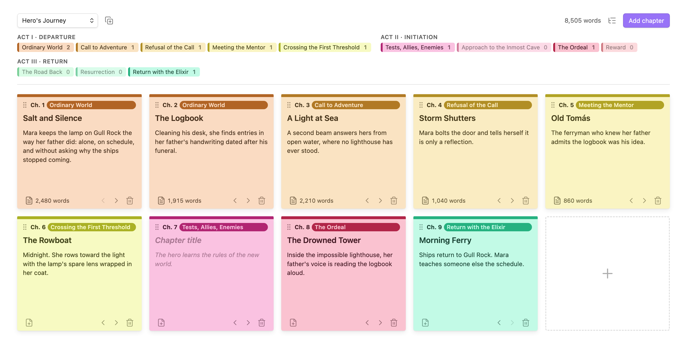
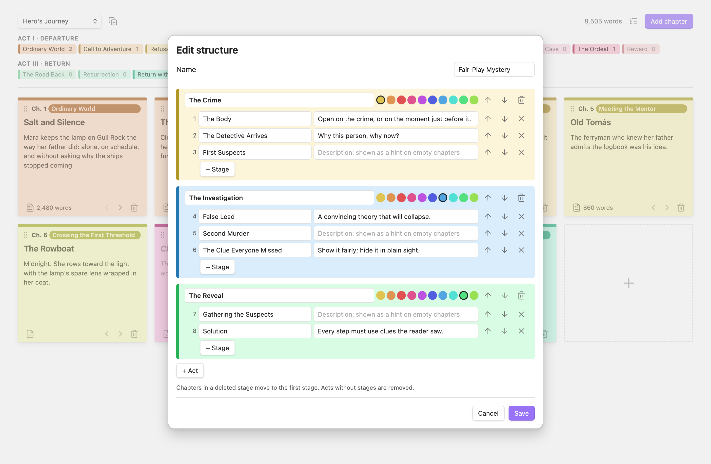
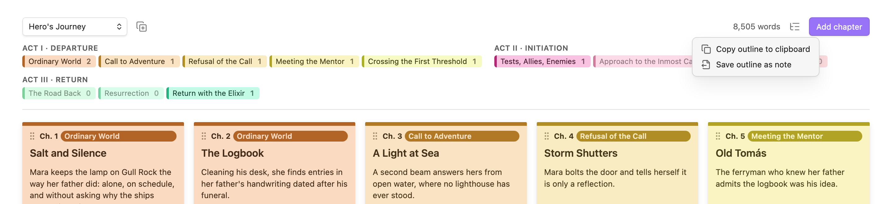
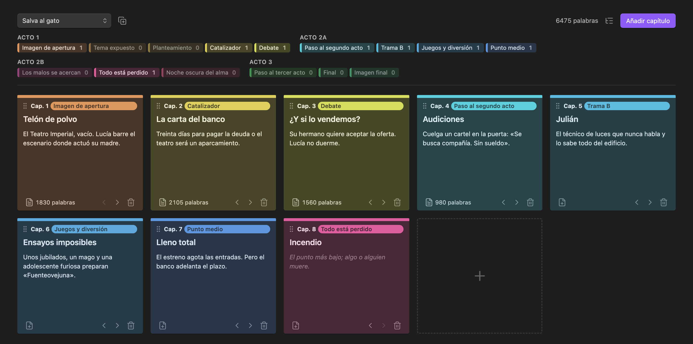

# Novel Structure Board

Plan your novel on a wall of post-its. Each card is a chapter, and its color shows where it falls in your story structure: the Hero's Journey, Save the Cat, Three Acts, or one you design yourself.



## Features

- **One post-it per chapter**, with a title, a short summary and a stage. Empty cards show a hint about what the stage is for.
- **Colors that follow the structure.** Stages in the same act share a color family, so you can see the shape of your book at a glance.
- **A legend that doubles as a map.** It shows how many chapters each stage has, so missing beats stand out. Click a stage to add a chapter there.
- **Linked chapter notes.** One click creates `03 - Title.md` in a folder next to the board and opens it. Your prose lives in normal Markdown notes, with search, links and backlinks.
- **Word counts** for each chapter and for the whole novel, updated as you write.
- **Reorder freely.** Drag cards by the grip, or use the arrows (handy on mobile).
- **Custom structures.** Design your own acts and stages, or start from a copy of a built-in one.
- **Outline export.** Copy the board as a Markdown outline, or save it as a note.
- **English and Spanish.** The interface and all stage names are translated.

## Structures

| Structure | Stages | Grouping |
|---|---|---|
| Hero's Journey (Vogler) | 12 | Departure · Initiation · Return |
| Save the Cat | 15 | Act 1 · Act 2A · Act 2B · Act 3 |
| Three-Act Structure | 8 | Setup · Confrontation · Resolution |
| Seven-Point Structure | 7 | — |
| Freytag's Pyramid | 5 | — |
| Kishōtenketsu | 4 | — |
| **Your own** | any | any |

You can switch a board's structure at any time. Each chapter moves to the stage at the same relative position, so an opening stays an opening and an ending stays an ending.

## Getting started

1. Run **New novel board** from the ribbon icon or the command palette, or right-click a folder.
2. Give it a name and pick a structure. This creates a `Name.storyboard` file in your vault.
3. Click a stage in the legend to add a chapter, or press **One chapter per stage** to fill the board with a template.
4. Write a title and a summary on each card. Click the file icon to create the chapter note and start writing. Ctrl/Cmd-click opens the note in a split.

Renaming or moving chapter notes doesn't break the links.

## Custom structures



Create structures in **Settings → Novel Structure Board → Custom structures**. Start blank, or copy any existing structure.

- **Acts** have an optional name and a color from a post-it palette. Stages in an act get shades of its color automatically.
- **Stages** have a name and a description. The description is the hint shown on empty cards.
- The ↑/↓ buttons reorder stages and acts. Moving a stage past the edge of its act moves it into the neighboring act.

On a board, the **copy** button next to the structure menu turns the current structure into an editable copy and switches the board to it, keeping every chapter in its stage. For a custom structure, the **pencil** button edits it.

## Outline export



The list button in the board's header, or the command palette, gives you two options. **Copy outline to clipboard** copies a Markdown outline. **Save outline as note** writes it to `Name - Outline.md` next to the board. Chapters stay in board order under act and stage headings:

```markdown
# The Lighthouse Keeper

Hero's Journey · 9 chapters · 8,505 words

## Act I · Departure

### Ordinary World

- **Ch. 1 · Salt and Silence** — [[01 - Salt and Silence]] (2,480 words)

  Mara keeps the lamp on Gull Rock the way her father did…
```

## En español



Choose **Español** in the settings. The board, menus and all stage names switch language: *El viaje del héroe*, *Salva al gato*, *Estructura en tres actos* and more. The plugin also follows Obsidian's light and dark themes.

## Settings

| Setting | Description |
|---|---|
| Language | English or Spanish. The default follows Obsidian's language. |
| Default structure | The structure preselected for new boards. |
| Custom structures | Create, edit and delete your own structures. |

## How your data is stored

- A board is a `.storyboard` file: plain JSON with the structure and the chapter cards (title, summary, stage, linked note path). It syncs like any other file in your vault.
- Chapter text lives in ordinary Markdown notes. Each note has `board` and `stage` properties.
- Custom structures are saved in the plugin's settings (`data.json`).

Removing the plugin leaves your chapter notes untouched.

## Installation

**From Community plugins** (once it's listed): go to **Settings → Community plugins → Browse**, search for *Novel Structure Board*, then install and enable it.

**Manually:** copy `main.js`, `manifest.json` and `styles.css` into `<vault>/.obsidian/plugins/novel-structure-board/`. Then reload Obsidian and enable the plugin under **Settings → Community plugins**.

## Development

```bash
npm install
npm run build        # type-check and bundle main.js
npm test             # logic tests (node --test)
npm run dev          # rebuild on change
npm run screenshots  # regenerate the images in docs/images (macOS, needs Obsidian and Chrome)
```

The screenshots are rendered from the plugin's real view code, styled with Obsidian's own stylesheet, which is read from your local Obsidian install and never committed.

## Support

If this plugin helps you write, you can buy me a coffee:

<a href="https://www.buymeacoffee.com/coffeedrivendev"></a>

## License

[MIT](LICENSE) © Elisa De Gregorio
